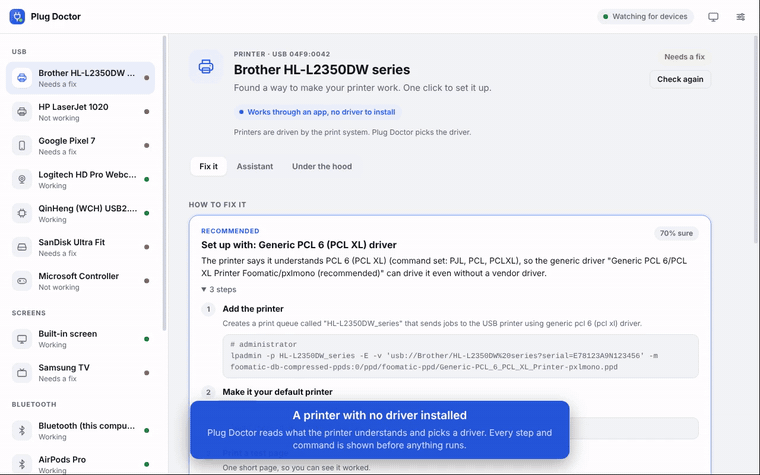
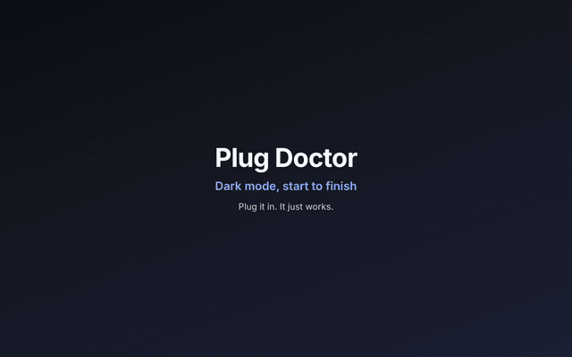

<p align="center">
  
</p>

<h1 align="center">Plug Doctor</h1>

<p align="center">
  <strong>Plug it in. It just works.</strong>
</p>

<p align="center">
  Plug Doctor tells you what you connected to your computer, whether it can work,<br>
  and walks you through making it work. Printers, TVs, phones, headphones, drives and more.
</p>

<p align="center">
  <a href="https://github.com/katesaikishore/plug-doctor/actions/workflows/ci.yml"></a>
  
  
  
</p>

<p align="center">
  <a href="docs/media/plug-doctor-demo.mp4">
    
  </a>
  <br>
  <a href="docs/media/plug-doctor-demo.mp4"><strong>▶ Watch the 2-minute demo</strong></a>
</p>

---

## Has this ever happened to you?

- Your printer is on, but nothing comes out.
- Your TV looks jerky, and the picture is cut off at the edges.
- Your headphones are connected, but the sound still plays from the speakers.
- Your Android phone is plugged in, but your Mac can't see its files.
- Your Bluetooth keyboard won't connect.
- Your USB stick opens on Windows but not on your Mac.

You search the internet, find a forum post from years ago, and try things until something works. Plug Doctor does that search for you, explains what it found in plain words, and offers a fix that you can read and approve before anything changes.

## How it works

1. **Plug it in.** Plug Doctor notices it within a few seconds.
2. **Read the answer.** Every device gets one clear verdict:
   - **Working**: nothing to do.
   - **Needs a fix**: Plug Doctor has a fix ready.
   - **Not working**: Plug Doctor explains why.
   - **Can't work on this computer**: Plug Doctor says so, and tells you what does work instead.
3. **Click "Make it work".** You see every step first. Your computer asks for your password when it needs to. Some steps, like tapping a button on your phone, wait until you say you've done them.

Plug Doctor follows your computer's light or dark mode. You can also pick one with the button at the top of the window.

<p align="center">
  <picture>
    <source media="(prefers-color-scheme: dark)" srcset="docs/screenshots/fix-plan-dark.png">
    
  </picture>
</p>

## Try it in one minute

You don't need any devices to try it. The demo shows a simulated Mac with sixteen devices, including a printer, a phone, a TV, headphones, a webcam, a drive and a game controller.

<p align="center">
  <a href="docs/media/plug-doctor-dark-demo.mp4">
    
  </a>
  <br>
  <a href="docs/media/plug-doctor-dark-demo.mp4"><strong>▶ Watch it in dark mode, start to finish (38 seconds)</strong></a>
</p>

You need [Node.js](https://nodejs.org) version 22.12 or newer. Then open a terminal and type:

```sh
git clone https://github.com/katesaikishore/plug-doctor.git
cd plug-doctor
npm install
npm run demo
```

Click around. Demo mode reads and changes nothing on your computer. If you turn on the AI assistant, the simulated devices are still sent to the AI provider you picked when you ask it something.

## Use it with your own devices

```sh
npm start
```

The app opens and starts watching your computer. Plug something in and watch it appear.

Ready-to-download installers for Mac, Windows and Linux will be attached to the first release. Until then, running from source is the way to go.

> **The first time you open it,** Mac and Windows will warn you, because Plug Doctor isn't signed by Apple or Microsoft yet. On a Mac, right-click the app and choose **Open**. On Windows, click **More info**, then **Run anyway**. All the code is in this repository if you want to check it first.

## Which computers does it work on?

| Computer | How complete it is today |
| --- | --- |
| **Mac** (Intel and Apple silicon) | **Most complete.** Built around the limits of newer Macs, and it says plainly when something can't work. |
| **Windows** | **Works, with fewer fixes so far.** Finds devices and explains problems. Some fixes are still "open this page and do this". |
| **Linux** | **Works well**, for people comfortable with a terminal. Fixes use your system's own package manager. |

These claims come from automated tests that run on all three systems. Testing on many different real devices is the next big step, and it's where you can help. See [Help make it better](#help-make-it-better).

## What it can help with

| Device | What Plug Doctor does |
| --- | --- |
| **Printers** | Finds a driver that works, or sets up a printer that needs no driver at all. Adds it, makes it the default, and prints a test page. |
| **Network printers and scanners** | Finds printers and scanners on your home network and sets them up. Many need no driver. |
| **TVs and screens** | Finds a screen stuck at a low refresh rate (usually the cable or adapter is the cause), a picture that doesn't fill the screen, and a resolution lower than it should be. |
| **Smart TVs and speakers** | Works out how to cast or mirror to your TV or speaker from your computer, and tells you what your computer can't do. |
| **Bluetooth** | Switched-off or blocked Bluetooth, devices that won't reconnect, low battery (including each AirPods earbud), and headphones that aren't being used for sound. |
| **Phones** | Gets your Android phone's files onto a Mac, tells you when a phone is stuck in "charge only" mode, and helps with iPhones on Linux and Windows. |
| **Webcams and cameras** | Checks camera permissions, and whether another app is using the camera. |
| **Scanners** | Gets scanners working through the system's own scanning tools. |
| **Headphones, microphones and music gear** | Finds audio devices, and offers to switch the sound output to them. |
| **Game controllers and drawing tablets** | Explains which controllers work on your computer, and sets up the ones that do. |
| **USB Ethernet and Wi-Fi adapters** | Explains whether an adapter can work with your computer. |
| **Drives and USB sticks** | Opens drives that aren't opened yet. Explains why some drives can't be written to on a Mac. Never erases anything for you. |
| **Arduino and other dev boards** | Finds the board's port, and fixes common problems that block it. |
| **Anything else** | Says whether your computer already knows the device, and gives you a report you can share to get help. |

<p align="center">
  <picture>
    <source media="(prefers-color-scheme: dark)" srcset="docs/screenshots/unsupported-dark.png">
    
  </picture>
</p>

## What it won't do

- **It won't lower your Mac's security** to make an old driver load. On newer Macs that isn't safe, so Plug Doctor tells you what works instead.
- **It won't erase your drives**, and it won't delete software or overwrite your files.
- **It can't make everything work.** Some devices have no driver for your computer. Plug Doctor says so rather than pretending.
- **Some problems have no automatic fix yet.** For example, the HP LaserJet 1020 on a Mac has no ready-made fix. You'll see a clear message, and the AI assistant can help you look for options.

## Is it safe?

- **You see every command before it runs.** The exact steps are shown in plain text before anything changes.
- **Its built-in fixes add things,** like a printer or a helper package, or switch off a conflicting service. They never remove software.
- **Passwords go through your computer's own prompt.** Plug Doctor never sees your password.
- **Apart from the AI assistant, the only internet use is fixes that install software.** Those download from your system's own software sources. The home-network scan only looks at your own network.

## Your privacy

- Plug Doctor has no accounts and doesn't track you.
- The **AI assistant** is optional. If you use it, what it sends to the AI provider you pick (Anthropic's Claude unless you choose another) includes your messages, the list of devices Plug Doctor can see (their names, IDs and details, which can include serial numbers), the checks Plug Doctor has run on the device you asked about, and the output of any read-only system checks the assistant runs. With web research on, it also sends search queries to the web. If you pick a model that runs on your own computer (Ollama or LM Studio), nothing leaves it.
- Your AI key is stored encrypted in your computer's keychain. It is never shown on screen.

## The optional AI assistant

Plug Doctor's checks work without the internet, and so do fixes that only change a setting. Fixes that install software need the internet to download it. For the harder problems, you can turn on the **AI assistant**. It uses [Claude](https://claude.ai) from Anthropic unless you pick another AI.

You choose the AI in **Settings**:

| Choice | What it is |
| --- | --- |
| **Claude (Anthropic)** | Recommended. Also searches the web for drivers and known fixes. |
| **Open models** | DeepSeek, Mistral, and open models such as Llama, Qwen and gpt-oss through Groq, OpenRouter or Together AI. |
| **On your own computer** | Ollama or LM Studio run an open model on your computer, for free. Nothing leaves it. Pick a model that can use tools. |
| **Other closed models** | OpenAI, Google Gemini and xAI's Grok. |
| **Another server** | Anything that speaks the OpenAI Chat Completions format with tools. |

Paste the API key from the provider you pick. Keys are stored encrypted, one per provider. Providers charge for API use, so check their pricing first. Web research works with Claude only.

Claude is a trademark of Anthropic, PBC, and the other AI names are trademarks of their owners. Plug Doctor is an independent open-source project, not affiliated with or endorsed by any of them.

The assistant can look at what your computer sees, search the web for drivers and known fixes, and propose a fix. **It never changes anything without asking you first.** It can only run a short list of commands, checked one by one, and it can't remove software or delete a print queue.

## Command line

If you prefer the terminal, or your computer has no screen, the same checks are available as commands:

```sh
npm run cli -- list                    # see what is connected
npm run cli -- diagnose                # check everything
npm run cli -- diagnose brother        # check devices whose name contains "brother"
npm run cli -- fix brother             # check, then apply a fix after you confirm
npm run cli -- report brother          # a report you can paste into a GitHub issue
npm run cli -- watch                   # keep watching while you plug things in
```

Add `--demo` to any command to try it on the simulated Mac. Add `--help` to see every option.

## Help make it better

Plug Doctor is new, and the most useful thing you can do is test it on your own devices.

- **Tell us what worked, and what didn't.** Open the *Under the hood* tab for a device and click **Ask the community on GitHub**. It fills in a report for you.
- **Share a fix that worked for you.** The assistant can write a fix up as a *recipe*, so the next person with the same device gets it in one click. See [docs/ADDING_A_DEVICE.md](docs/ADDING_A_DEVICE.md).
- **Help with code or translations.** Read [CONTRIBUTING.md](CONTRIBUTING.md). Translations are especially welcome, because many people who need this most don't read English.

Found a security problem? Please report it privately, as described in [SECURITY.md](SECURITY.md).

## Questions people ask

**Is it free?** Yes. The code is free and open source under the MIT license. The optional AI assistant needs an API key from the AI provider you pick, which you pay for directly, or it can use a free open model running on your own computer.

**Does it need an account or an internet connection?** No account is needed. The checks work without the internet. Fixes that install software need it, and so does the AI assistant.

**Will it change my computer without asking?** Only in one case. Auto-fix is on by default: when you plug in a USB device, Plug Doctor may run a safe fix on its own, such as adding a printer. Those fixes only add things. You can turn auto-fix off in Settings.

**Why is it called Plug Doctor?** Because it does what a good repair person does: asks what's wrong, explains it, and fixes it with you.

**Who made it?** [Kate Sai Kishore](https://github.com/katesaikishore), built with help from [Claude](https://claude.ai), Anthropic's AI model.

## For developers

<details>
<summary><strong>How it's built</strong></summary>

<br>

Plug Doctor is written in plain Node.js, with [Electron](https://www.electronjs.org) for the window. It has no native modules, so it installs anywhere without a compiler.

```
 Where devices come from          Plug-ins that understand each kind of device
 ───────────────────────          ──────────────────────────────────────────────
 USB                              printer · storage · serial · phone · camera
 Screens and TVs                  scanner · audio · input · display
 Bluetooth                        bluetooth · network-device · network-adapter
 Home network (mDNS, SSDP)        generic (fallback for everything else)
                                       │
                 support verdict  ◄────┤  + community recipes (knowledge/devices)
                                       ▼
                 fix plans: run a command · a manual step · open a settings page
                                       │
                                       ▼
                 runner: allow-listed commands only · your system's password prompt
```

- Adding a new kind of device is one file. See [docs/FAMILIES.md](docs/FAMILIES.md).
- The full design is in [docs/ARCHITECTURE.md](docs/ARCHITECTURE.md).

**Tests**

```sh
npm test       # unit tests, run on macOS, Windows and Linux in CI
npm run e2e    # end-to-end check of the real app in demo mode (needs Playwright; on Linux, run it under xvfb-run)
node scripts/screenshots.js   # README screenshots, in light and dark
```

</details>

<details>
<summary><strong>Project layout</strong></summary>

<br>

| Folder | What's in it |
| --- | --- |
| `src/core/` | Device detection, diagnosis, fix plans and the command runner. Works without the app window, so the command line uses it too. |
| `src/core/families/` | One file per kind of device: how to recognise it, what to check, how to fix it. |
| `src/core/sources/` | Where devices come from: USB, screens, Bluetooth, and the home network. |
| `src/main/` | The Electron app's main process: windows, settings, the assistant. |
| `src/renderer/` | What you see on screen. |
| `knowledge/devices/` | Community recipes, one small JSON file per device or device family. |
| `bin/` | The command-line tool. |
| `test/` | Unit tests, with recorded command output as test data. |
| `docs/` | Guides for contributors. |

</details>

## License

[MIT](LICENSE). Plug Doctor isn't affiliated with HP, Apple, Microsoft, Google, Canon, Brother, Epson, Logitech, Sony, Nintendo, WCH, Silicon Labs, FTDI, Prolific, Arduino or any other company named here. Their names are used only to identify the devices.
