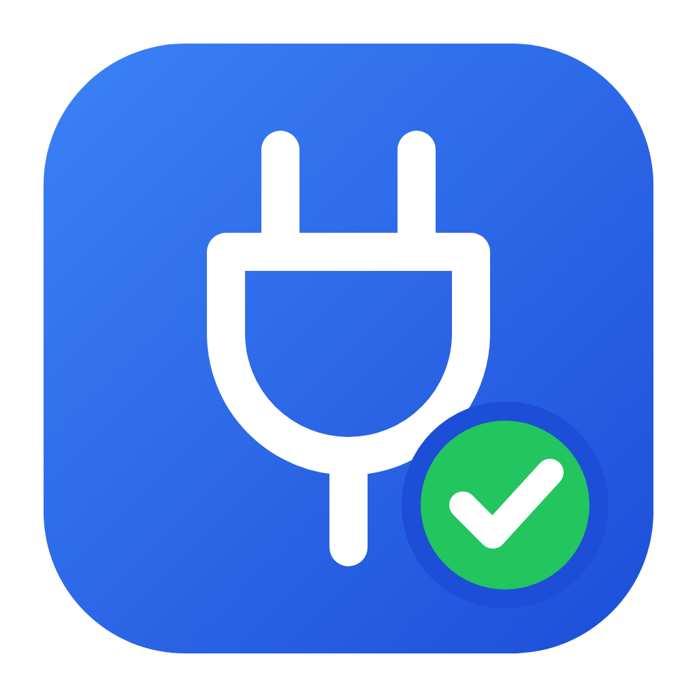
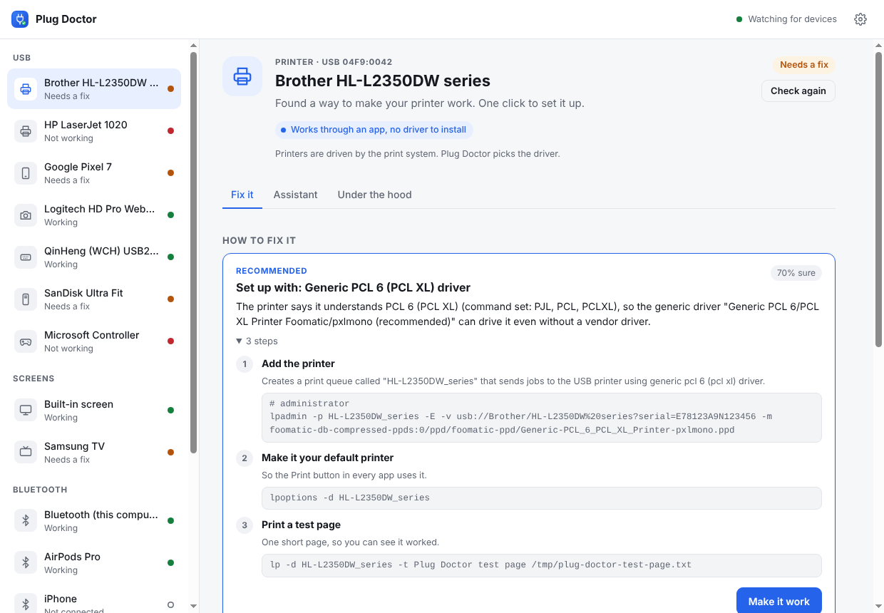
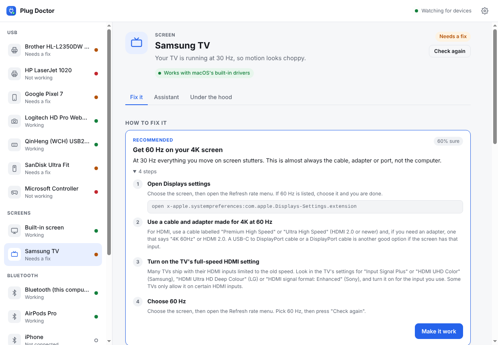
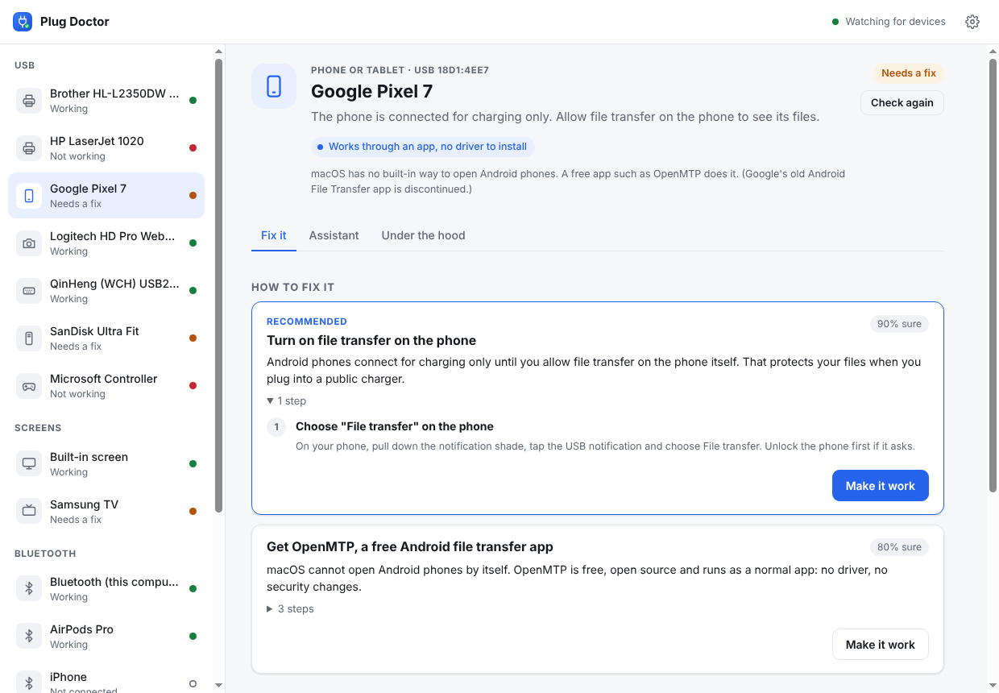
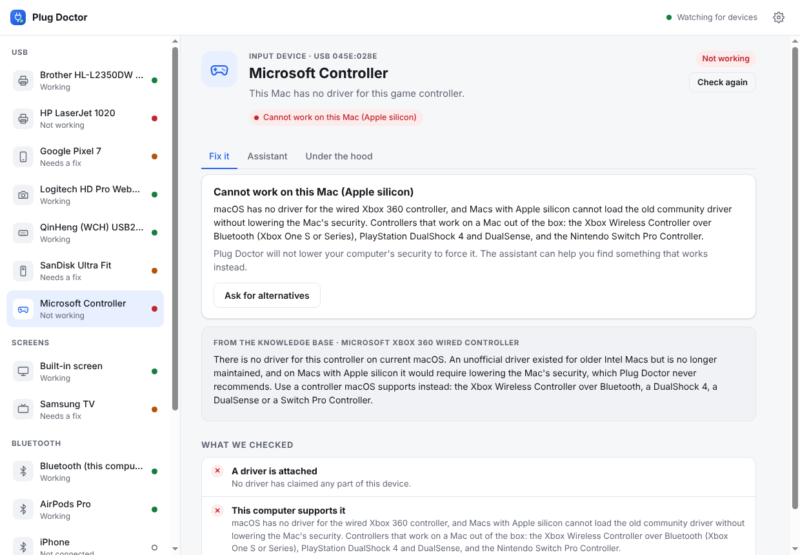
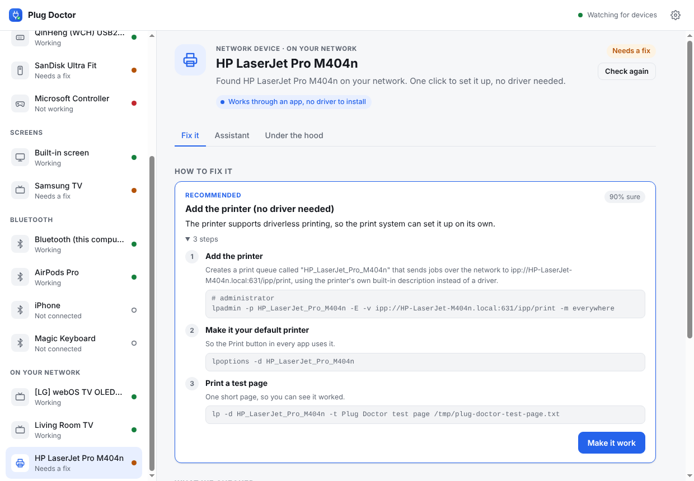

<p align="center"></p>

<h1 align="center">Plug Doctor</h1>

<p align="center"><strong>Plug it in. It just works.</strong><br>
A free, open-source desktop app that works out what you connected (a USB device, a screen or TV, a Bluetooth gadget, something on your home network), checks whether your computer can use it, and fixes it if it can. Mac first, and also on Windows and Linux.</p>

---

My HP printer had no driver for macOS. With help from Claude I worked out what the printer actually was and what it spoke, found a driver that could drive it, and it printed. **Plug Doctor turns that process into an app anyone can use**: plug the device in, and it runs the troubleshooting a patient expert would.



## What it does

1. **Watches for devices.** USB every 2 seconds, screens every 5, Bluetooth every 10, and your home network every minute.
2. **Identifies each device** from what it reports about itself: USB IDs and interface classes and which driver took it, a screen's EDID, a printer's IEEE 1284 ID (the page languages it speaks), Bluetooth state, the services a TV advertises on the network.
3. **Gives a verdict first: can this computer use it at all?** Works with built-in drivers, works through an app, needs the maker's driver, or **cannot work on this computer**, said plainly. On Macs with Apple silicon, Plug Doctor never suggests lowering the Mac's security to load old drivers. It finds what works without that, or tells you honestly.
4. **Runs checks** for that kind of device and explains the results in plain language.
5. **Fixes it.** Each fix is a short list of steps with the exact commands shown. One click runs them, and your OS asks for your password when a step needs it. Steps only you can do (on your phone, on the TV remote) pause until you click "I've done this". With *Fix automatically* on, safe fixes for things you just plugged in (adding a printer, for example) run by themselves.
6. **Asks for help when it is stuck (optional).** An AI assistant (Anthropic's Claude) looks at what your computer sees, researches the device and proposes fixes. **Every change it suggests needs your approval.**
7. **Shares what worked.** A fix that worked becomes a *recipe* in the community knowledge base, so the next person with that device gets it in one click.

### What it knows today

| Device | What Plug Doctor does |
| --- | --- |
| **USB printers** | Reads the printer's IEEE 1284 ID through CUPS and picks a driver: a community recipe, driverless IPP-over-USB, an installed driver for the exact model, then a **generic driver for the language the printer speaks** (PostScript, PCL 6, PCL 5, ESC/P). Adds the printer, makes it the default and prints a test page. Resumes paused printers. Host-based "GDI" printers (like the HP LaserJet 1020) get model-specific recipes. On Windows: Device Manager problem codes, Windows Update and the Microsoft class driver. |
| **Network printers and scanners** | Finds them on your network (mDNS/Bonjour) and adds AirPrint / IPP Everywhere printers **with no driver at all**. Network scanners work through Image Capture on Mac and `sane-airscan` on Linux. |
| **Screens and TVs** | Reads every connected screen's EDID. Catches **4K stuck at 30 Hz** (an old cable or adapter), a resolution below the screen's native one, and **base M1/M2 Macs that can only drive one external screen** (explains DisplayLink). For TVs: overscan ("picture cut off"), PC/Game mode for sharp text, HDR, and why a Mac can't use the TV remote over HDMI (CEC). DisplayLink docks: checks for DisplayLink Manager. |
| **TVs and speakers on your network** | Smart TVs, AirPlay (Apple TV, AirPlay 2 TVs, HomePod), Chromecast / Google TV, DLNA, DIAL and Roku. Tells you exactly how to cast or mirror from *this* computer, and what isn't possible (a Mac can't mirror to a non-AirPlay TV on its own). HomeKit accessories that aren't set up yet. |
| **Bluetooth** | Bluetooth switched off or blocked, the service not running (Linux), no Bluetooth hardware at all, devices that won't reconnect (reconnect or pair again), low battery including each AirPods earbud and the case, headphones connected but sound still coming from the speakers. |
| **Phones** | **Android file transfer on a Mac** (macOS has none built in: sets up OpenMTP), phones stuck in charge-only mode ("tap the USB notification, choose File transfer"), Android on Linux (file-manager support), iPhone trust prompts, and iPhones on Linux (usbmuxd / libimobiledevice) and Windows (Apple Devices). |
| **Webcams and cameras** | Webcam permissions on Mac and Windows, missing `/dev/video` nodes, the `video` group and another app holding the camera on Linux; still cameras via Image Capture or gphoto2. |
| **Scanners** | SANE on Linux (including the driverless backend), Image Capture on Mac, recipes for Canon LiDE models. |
| **Audio, MIDI, game controllers, tablets, network adapters** | Class-compliant audio interfaces and MIDI devices, choosing the sound output, Xbox / PlayStation / Switch controllers (and an honest answer for the old wired Xbox 360 controller on Apple silicon), drawing tablets, USB Ethernet and Wi-Fi adapters (USB Wi-Fi dongles have no drivers for Apple-silicon Macs, and the app says so). |
| **USB serial adapters and dev boards** | Arduino, ESP32, CH340, CP210x, FTDI, PL2303: finds the port (on Mac straight from the IORegistry), fixes Ubuntu's *brltty steals my serial port*, loads missing kernel modules, grants serial-port access. |
| **USB drives** | Disks, partitions and filesystems; mounts unmounted volumes; explains limits (a Mac can read but not write NTFS) and never erases anything without you doing it yourself. |
| **Anything else** | The support verdict, generic driver and error-code checks, and an *Under the hood* report with the raw descriptors and how to capture the device's USB traffic. That is the starting point for reverse engineering it. |

| | |
| --- | --- |
|  |  |
| **Screens and TVs:** a 4K TV stuck at 30 Hz, and how to get 60 Hz. | **Phones:** charge-only mode, and Android file transfer on a Mac. |
|  |  |
| **Honest answers:** no driver exists for Apple silicon, so it says so and names what works. | **Your network:** AirPrint / IPP Everywhere printers set up in one click. |

## Install

Every tagged version is built for macOS (`.dmg`), Windows (installer) and Linux (`.AppImage`, `.deb`) and published on [Releases](https://github.com/katesaikishore/plug-doctor/releases).

Or run from source (Node.js 20+):

```sh
git clone https://github.com/katesaikishore/plug-doctor.git
cd plug-doctor
npm install
npm start          # the app
npm run demo       # a simulated Mac with a desk full of devices: try it with nothing plugged in
npm run cli -- list            # command line: list devices (add --no-network to skip the network scan)
npm run cli -- diagnose        # command line: diagnose everything plugged in
npm run cli -- fix hl-l2350    # command line: diagnose and fix one device
```

### The AI assistant (optional)

Plug Doctor's own checks and fixes work offline and need no account. The assistant uses Anthropic's Claude API: open **Settings**, paste an API key from [console.anthropic.com](https://console.anthropic.com), and it is stored encrypted in your system keychain. You can also set `ANTHROPIC_API_KEY` in the environment.

When you use the assistant, it sends the device details, Plug Doctor's diagnosis and the output of the read-only probes it runs to the API. It cannot run arbitrary commands:

- **Read-only probes** are named, fixed commands (`lsusb -v`, `lpinfo -m`, `ioreg`, `pnputil /enum-drivers`, ...). It never gets a shell.
- **Changes** go through `propose_fix`. You see every command, and nothing runs until you approve. Only a short allow-list of programs is accepted (CUPS tools, package installers, `usermod`, `modprobe`, `udevadm`, `pnputil`), and it may not remove software.
- Anything outside that list becomes step-by-step instructions for you to follow yourself.

## How it works

```
 sources                                    families (plug-ins)
 ───────                                    ───────────────────
 USB        sysfs · ioreg · PnP       ─┐     printer   storage   serial   phone
 Screens    EDID · system_profiler    ─┤     camera    scanner   audio    input
 Bluetooth  bluetoothctl · profiler   ─┼──►  display   bluetooth network-device
 Network    mDNS · SSDP (pure Node)   ─┘     network-adapter     generic (fallback)
                                              │
              support verdict ◄───────────────┤  + knowledge base recipes
                                              ▼
                               fix plans { command | manual | open-url }
                                              │
                                              ▼
              runner: allow-listed programs only · OS password prompt for admin steps
```

No native modules: everything is plain Node.js and the tools your OS already has, so it installs anywhere. Writing a new family takes one file; see [docs/FAMILIES.md](docs/FAMILIES.md).

There is more in [docs/ARCHITECTURE.md](docs/ARCHITECTURE.md).

## Contribute: every recipe helps someone

The most valuable contribution needs no code: **a recipe for a device you got working.** A recipe is a small JSON file in [`knowledge/devices/`](knowledge/devices) that says which device it is for and what made it work on each OS. CI checks every recipe, so a typo cannot break anyone's printer. See [docs/ADDING_A_DEVICE.md](docs/ADDING_A_DEVICE.md).

Got a device nothing can drive? Open the *Under the hood* tab, click **Ask the community on GitHub**, and paste the report. [docs/REVERSE_ENGINEERING.md](docs/REVERSE_ENGINEERING.md) explains how to go further.

Code contributions are welcome too. See [CONTRIBUTING.md](CONTRIBUTING.md). Wanted next:

- **Test reports from real hardware.** Every family was built from documented tool output; real Macs, PCs and devices will find the rough edges.
- Windows: read the printer's IEEE 1284 ID and pick a class driver by language; per-screen refresh rates
- More recipes: printers, scanners, docks, controllers, anything you got working
- Translations: the people who need this most often don't read English

## Safety

- Every command is shown before it runs. Fixes only *add* things (a printer queue, a package, a group membership). The built-in plans never delete anything.
- Administrator steps use your OS's own prompt (polkit, macOS authorization dialog, UAC). Plug Doctor never sees your password.
- The page cannot run commands. It can only ask the main process to run a fix by its ID, and the main process looks that plan up again from its own diagnosis.
- Report security issues privately. See [SECURITY.md](SECURITY.md).

## License

[MIT](LICENSE). Plug Doctor is not affiliated with HP, Brother, Epson, WCH, Silicon Labs, FTDI, Prolific, Arduino or any other vendor named here. Their names are used only to identify their devices.
