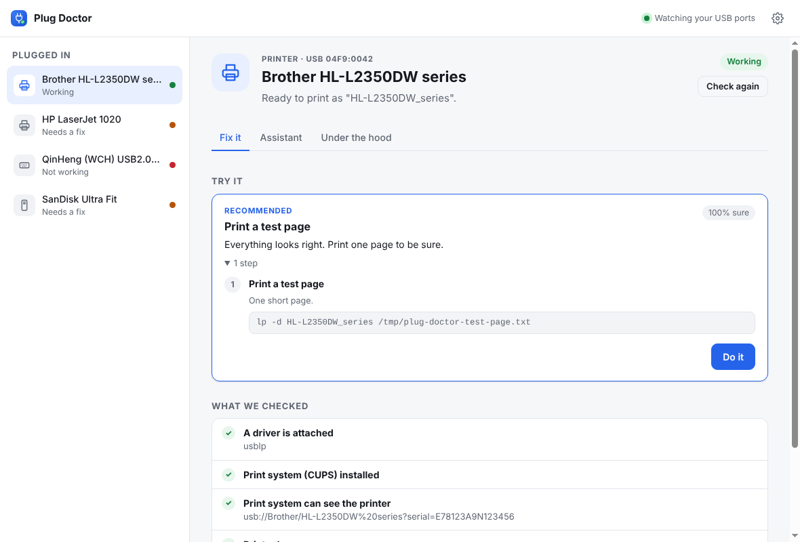

<p align="center"></p>

<h1 align="center">Plug Doctor</h1>

<p align="center"><strong>Plug in a USB device. It just works.</strong><br>
A free, open-source desktop app that works out what you plugged in, checks whether your computer can use it, and fixes it if it can.</p>

---

My HP printer had no driver for macOS. With help from Claude I worked out what the printer actually was and what it spoke, found a driver that could drive it, and it printed. **Plug Doctor turns that process into an app anyone can use**: plug the device in, and it runs the troubleshooting a patient expert would.


## What it does

1. **Watches your USB ports.** Plug something in and Plug Doctor notices within two seconds.
2. **Identifies the device** from what it reports about itself: vendor and product IDs, USB interface classes, the driver the OS attached (if any), and for printers the IEEE 1284 device ID, which lists the page languages the printer speaks.
3. **Runs checks** for that kind of device and explains the results in plain language.
4. **Fixes it.** Each fix is a short list of steps with the exact commands shown. One click runs them; your OS asks for your password when a step needs it. With *Fix automatically* on, safe fixes (adding a printer, for example) run as soon as you plug the device in.
5. **Asks for help when it is stuck (optional).** An AI assistant (Anthropic's Claude) looks at what your computer sees, researches the device, and proposes fixes. **Every change it suggests needs your approval.**
6. **Shares what worked.** A fix that worked can be saved as a *recipe* in the community knowledge base, so the next person with that device gets it in one click.

### What it knows today

| Device | What Plug Doctor does |
| --- | --- |
| **Printers** (macOS, Linux) | Finds the printer through CUPS, reads its IEEE 1284 ID, and picks a driver: a community recipe, then driverless IPP-over-USB, then an installed driver for the exact model, then a **generic driver for the language the printer speaks** (PostScript, PCL 6, PCL 5, ESC/P). It sets up the queue, makes it the default printer and prints a test page. It can also resume a paused queue. Host-based "GDI" printers are flagged as needing model-specific software. |
| **Printers** (Windows) | Reads Device Manager problem codes and offers a Windows Update driver search or the built-in Microsoft PCL6 class driver. |
| **USB-serial adapters and dev boards** (Arduino, ESP32, CH340, CP210x, FTDI, PL2303) | Checks that a port appeared. On Linux it fixes the Ubuntu *brltty steals my serial port* problem, loads a missing kernel module, and grants your account access to serial ports. On macOS it links to the chip maker's driver. |
| **USB drives** | Finds the disk and its partitions, mounts unmounted ones, and explains filesystem limits (for example, macOS cannot write to NTFS). |
| **Anything else** | Generic driver and error-code checks, plus an *Under the hood* report: the raw descriptors, interface classes and drivers, and how to capture the device's USB traffic. That is the starting point for reverse engineering it. |



## Install

Every tagged version is built for macOS (`.dmg`), Windows (installer) and Linux (`.AppImage`, `.deb`) and published on [Releases](https://github.com/katesaikishore/plug-doctor/releases).

Or run from source (Node.js 20+):

```sh
git clone https://github.com/katesaikishore/plug-doctor.git
cd plug-doctor
npm install
npm start          # the app
npm run demo       # the app with four simulated devices: try it with nothing plugged in
npm run cli -- list            # command line: list devices
npm run cli -- diagnose        # command line: diagnose everything plugged in
npm run cli -- fix hl-l2350    # command line: diagnose and fix one device
```

### The AI assistant (optional)

Plug Doctor's own checks and fixes work offline and need no account. The assistant uses Anthropic's Claude API: open **Settings**, paste an API key from [console.anthropic.com](https://console.anthropic.com), and it is stored encrypted in your system keychain. You can also set `ANTHROPIC_API_KEY` in the environment.

When you use the assistant, it sends the device details, Plug Doctor's diagnosis and the output of the read-only probes it runs to the API. It cannot run arbitrary commands:

- **Read-only probes** are named, fixed commands (`lsusb -v`, `lpinfo -m`, `ioreg`, `pnputil /enum-drivers`, ...). It never gets a shell.
- **Changes** go through `propose_fix`. You see every command, and nothing runs until you approve. Only a short allow-list of programs is accepted (CUPS tools, package installers, `usermod`, `modprobe`, `udevadm`, `pnputil`), and it may not remove software.
- Anything outside that list becomes step-by-step instructions for you to follow yourself.

## How it works

```
USB bus ──► watcher (polls every 2 s, no native modules)
             │  sysfs on Linux · ioreg on macOS · PnP on Windows
             ▼
          normalized device { vendorId, productId, interfaces[class/subclass/protocol/driver], problem }
             │
             ▼
          diagnose ── printer: CUPS + IEEE 1284 + driver strategy
             │        serial:  ports, brltty, groups, kernel modules
             │        storage: disks, filesystems, mounts
             │        + knowledge base recipes (knowledge/devices/*.json)
             ▼
          fix plans { steps: [command | manual | open-url] }
             │
             ▼
          runner ── allow-listed programs only · OS password prompt for admin steps
```

There is more in [docs/ARCHITECTURE.md](docs/ARCHITECTURE.md).

## Contribute: every recipe helps someone

The most valuable contribution needs no code: **a recipe for a device you got working.** A recipe is a small JSON file in [`knowledge/devices/`](knowledge/devices) that says which device it is for and what made it work on each OS. CI checks every recipe, so a typo cannot break anyone's printer. See [docs/ADDING_A_DEVICE.md](docs/ADDING_A_DEVICE.md).

Got a device nothing can drive? Open the *Under the hood* tab, click **Ask the community on GitHub**, and paste the report. [docs/REVERSE_ENGINEERING.md](docs/REVERSE_ENGINEERING.md) explains how to go further.

Code contributions are welcome too. See [CONTRIBUTING.md](CONTRIBUTING.md). Wanted next:

- Scanners (SANE / eSCL / WIA), cameras (PTP/MTP), audio interfaces
- Windows: read the printer's IEEE 1284 ID and pick a class driver by language
- macOS: driver-binding detection from the IORegistry
- Translations: the people who need this most often don't read English

## Safety

- Every command is shown before it runs. Fixes only *add* things (a printer queue, a package, a group membership). The built-in plans never delete anything.
- Administrator steps use your OS's own prompt (polkit, macOS authorization dialog, UAC). Plug Doctor never sees your password.
- The page cannot run commands. It can only ask the main process to run a fix by its ID, and the main process looks that plan up again from its own diagnosis.
- Report security issues privately. See [SECURITY.md](SECURITY.md).

## License

[MIT](LICENSE). Plug Doctor is not affiliated with HP, Brother, Epson, WCH, Silicon Labs, FTDI, Prolific, Arduino or any other vendor named here. Their names are used only to identify their devices.
